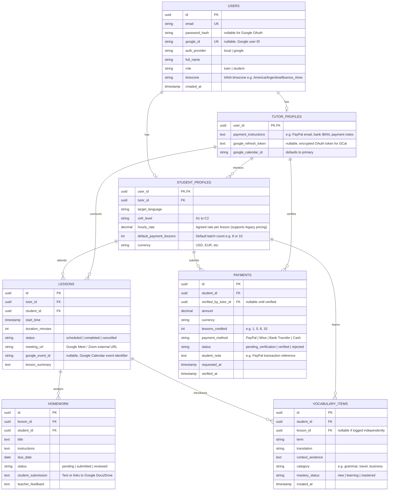
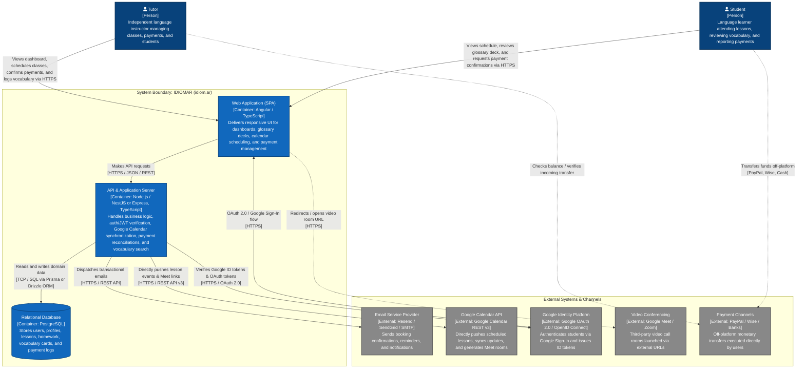
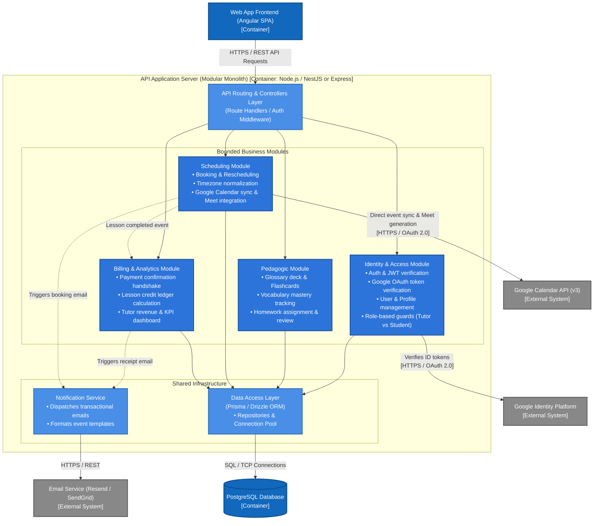
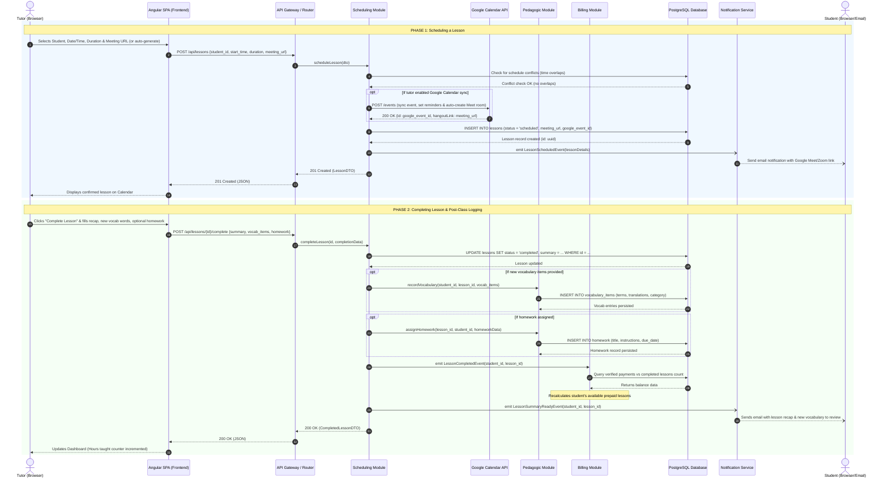
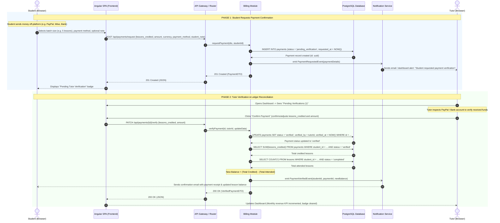
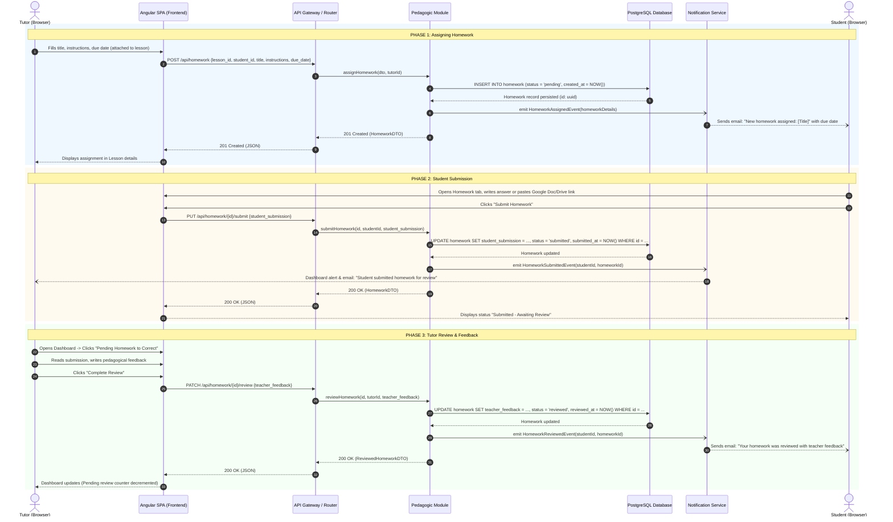

# IDIOMAR (idiom.ar) - Architecture & Database Diagrams

This directory contains the visual specifications for the **IDIOMAR** (idiom.ar) system (Proyecto Final de Graduación).

---

## 1. Entity-Relationship Diagram (ERD)
File: [01-erd.mmd](file:///Users/dima/Documents/Programming/IDIOMAR/docs/diagrams/01-erd.mmd)

---

## 2. C4 Level 2: Container Diagram
File: [02-c4-level2-containers.mmd](file:///Users/dima/Documents/Programming/IDIOMAR/docs/diagrams/02-c4-level2-containers.mmd)

---

## 3. C4 Level 3: Component Diagram (Modular Monolith Backend)
File: [03-c4-level3-components.mmd](file:///Users/dima/Documents/Programming/IDIOMAR/docs/diagrams/03-c4-level3-components.mmd)

---

## 4. UML Sequence Diagram: Lesson Lifecycle (Scheduling & Completion)
File: [04-sequence-lesson-lifecycle.mmd](file:///Users/dima/Documents/Programming/IDIOMAR/docs/diagrams/04-sequence-lesson-lifecycle.mmd)

---

## 5. UML Sequence Diagram: Payment Confirmation Handshake
File: [05-sequence-payment-confirmation.mmd](file:///Users/dima/Documents/Programming/IDIOMAR/docs/diagrams/05-sequence-payment-confirmation.mmd)

---

## 6. UML Sequence Diagram: Homework Lifecycle
File: [06-sequence-homework-lifecycle.mmd](file:///Users/dima/Documents/Programming/IDIOMAR/docs/diagrams/06-sequence-homework-lifecycle.mmd)

